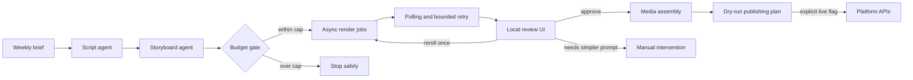

# Gus Agent Pipeline

A safety-first autonomous content pipeline that turns a weekly brief into short-form video episodes, routes generated clips through human review, assembles approved media, and prepares distribution across multiple platforms.

This public repository is a code-review sample. Private prompts, brand assets, generated media, account identifiers, and credentials are intentionally excluded.

## Why I built it

Generative workflows become risky when they can spend money or publish externally. I designed this pipeline around explicit operational guardrails:

- Dry-run behavior is the default for external actions.
- Estimated render cost is checked before any paid request is submitted.
- API calls use bounded retries rather than unbounded loops.
- Asynchronous video jobs are polled with a timeout and limited rerolls.
- Generated clips require human approval before assembly and publishing.
- Credentials come only from environment variables and are never logged.
- External services are mocked in the test suite.

## Architecture



## Code worth reviewing

- [`gus/render.py`](gus/render.py) — builds render plans, enforces spending limits, submits asynchronous jobs, polls them, and caps retries.
- [`gus/review.py`](gus/review.py) — provides a local approval UI and prevents paid rerolls unless live mode is explicitly enabled.
- [`gus/xai.py`](gus/xai.py) — wraps chat and video APIs with bounded backoff, typed results, and injectable transports for tests.
- [`gus/write.py`](gus/write.py) and [`gus/board.py`](gus/board.py) — validate structured model output before it enters later pipeline stages.
- [`tests/`](tests/) — 26 tests covering API failures, cost controls, dry-run behavior, rendering state, review actions, and media assembly.

## Safety model

The pipeline treats every costly or externally visible action as a separate boundary. Planning and validation can run offline. Rendering requires an API key and an explicit live flag. Publishing is dry-run by default. Human review sits between generation and final media assembly.

The checked-in configuration caps a render run at `$10`. Passing an override is deliberate and visible at the command line; it is never inferred from environment state.

## Run the tests

Requires Python 3.12.

```bash
python3.12 -m venv .venv
.venv/bin/pip install -r requirements.txt
.venv/bin/python -m pytest -q
```

Expected result:

```text
26 passed
```

The tests do not contact external services or spend API credit.

## Explore in dry-run mode

```bash
make setup
make test
make render
make post
```

Live operations require credentials and an explicit `LIVE=1`. Those operations are not needed to review or test this sample.

## Repository scope

This showcase includes the orchestration code and tests. It intentionally omits:

- system and character prompts;
- reference images and generated videos;
- social-account identifiers and OAuth material;
- production episode data and analytics;
- deployment-specific scheduling configuration.

Those exclusions keep the sample focused on engineering decisions while preventing private creative and account data from becoming public.
